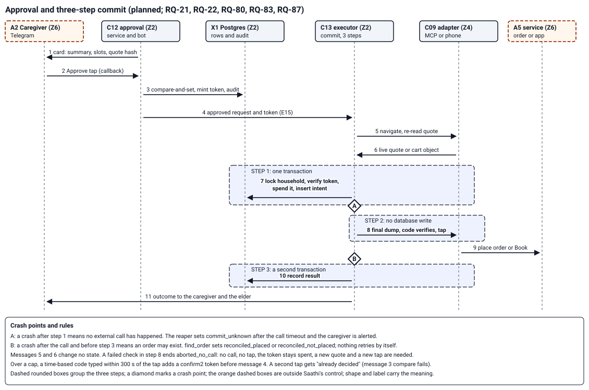

# Saathi

An open-source helper for older family members: they ask by WhatsApp voice note, and a family member approves anything that costs money with one tap.

*What Phase 0 does today, shown with synthetic text. It listens, checks and tells the family. It orders nothing yet.*

Saathi is a working codename; the public name comes later (D-90). Saathi is not an emergency service; it alerts your family. In an emergency, call 112, or 108 for an ambulance.

## Why

Many older people in India get stuck on everyday phone tasks: booking a ride, ordering groceries, telling a real message from a scam. They phone a son or daughter for each one.

Saathi takes the request in the elder's own words, in Hindi or everyday English, and does the work up to the final step. A caregiver approves that step from Telegram.

Evidence so far: the Phase 0 gate verifies 55 of its 68 rows in CI, with 0 invalid. The other 13 need owner receipts, such as the manual pilot and repository settings ([gate script](scripts/gate.py), [receipts](docs/evidence/receipts)).

## Features

- Voice notes, photos and text on WhatsApp; caregiver alerts and summaries on Telegram, with approvals from Phase 1.
- Emergency and scam radar: a keyword list checked first, so a match alerts the family without waiting for a model.
- A policy engine is the only path to an order. It needs a signed approval bound to the exact quote, cash on delivery, a spend cap and an address allowlist.
- Personal data leaves your server only by the routes the data policy lists, after a recorded reason; free hosted model tiers never see it.
- Every dependency is MIT, Apache-2.0 or a permissive infrastructure licence, checked in CI.

## How an order will be approved

*The approval and commit sequence planned for Phase 1. The caregiver taps Approve on a card; code checks the token against the quote before any order is placed.*

| Phase | Adds | State |
|---|---|---|
| 0 Foundation | voice intake, radar, caregiver summaries, audit, consent records | built; owner receipts pending |
| 1 Orders | approvals, groceries by official commerce servers, live alert calls | planned |
| 2 and later | rides, forwarded-message checks, more tasks | planned |

The full phase table is in [the product requirements](docs/design/PRD-saathi-2026-11-09-r2.md), section 8.

## Quick start

These steps run the tests on your machine. They need Python 3.12 and [uv](https://docs.astral.sh/uv/).

1. Install the dependencies: `uv sync`. Check: the command ends without an error.
2. Run the tests: `uv run pytest -q`. Check: the last line reports passed tests and no failures. Tests that need Postgres skip unless `SAATHI_TEST_DSN` is set.
3. Run the licence audit: `uv run python scripts/license_audit.py`. Check: it prints `license audit passed`.

To run Saathi on a server, follow [the setup guide](docs/SETUP.md).

## Read next

- [Architecture](docs/ARCHITECTURE.md) and [the design index](00-INDEX.md).
- [Setup](docs/SETUP.md) for a server, the WhatsApp app and the caregiver bot.
- [Decisions](docs/DECISIONS.md) and [the product requirements](docs/design/PRD-saathi-2026-11-09-r2.md).

## Licence

Apache-2.0. Container images are built for your own server and never published; see [the setup guide](docs/SETUP.md#container-images-are-never-published).
