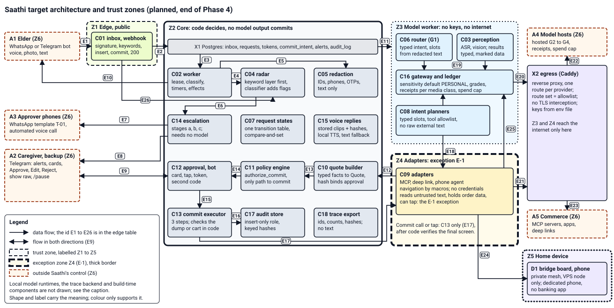

Read section 3 for what each component does and never does, section 4 for what crosses each trust boundary, and the parts in section 1 for states, ports, data, threats, checks and the build order.

# Saathi TRD: components, trust domains and design rules

## 1. Scope, marks and parts

The PRD, the SPECs and the POLICY files fix what must hold, by RQ and PL id. This TRD fixes how the system is built to hold it: components, trust domains, state machines, ports, data, technology choices, deployment and the Phase 0 build order. Files, functions and fields belong to the LLD, which is not written. Design rules carry ids TQ-nn; the checks part maps every RQ and PL id to at least one rule.

Marks follow PRD section 2. A code fact is E at 3d46456 with file and line. Every design element is P unless marked. RECORD D-69 (hybrid voice replies) is applied in section 5 and the ports part. D-70 (no checkpointer) is applied in the states and ops parts, D-71 (signed clips) in section 5, D-72 (PSF-2.0) in the ops part, D-73 (design check in CI) in the build part, D-74 (traces as files first) in the ops and build parts, and D-75 (external heartbeat) in the ops and threats parts. The strategy fold applies D-79 (elder channel port, elder bot) in the ports, threats and ops parts, D-82 (phone-agent fence) in the ports part, and D-83 (tenant isolation) in the ports, threats and build parts.

| Part | Holds |
|---|---|
| TRD-saathi-2026-11-09.md | architecture figure, components, trust domains, voice replies |
| TRD-saathi-checks-2026-11-09.md | TQ table with the RQ and PL coverage, the coverage script result, known limits |
| TRD-saathi-checks-product-2026-11-10.md | TQ rows and known limits for the strategy fold (channels, tenancy, consent, autonomy, fence, pilot) |
| TRD-saathi-states-2026-11-09.md | transition tables for request, commit_intent, alert event, inbox and approval token |
| TRD-saathi-threats-2026-11-09.md | threat table T-01 on, with what stops each and the residual risk |
| TRD-saathi-ports-2026-11-09.md | Protocol ports with signatures and errors, voice store, data model, database roles |
| TRD-saathi-ops-2026-11-09.md | technology choices, deployment, health probes |
| TRD-saathi-build-2026-11-09.md | code changes in the existing code, Phase 0 build order |

## 2. Architecture

Saathi is one Postgres database and a few restartable processes. State lives in rows, so a restart resumes every non-terminal row. Models propose slots, drafts and flags; code decides whether anything is sent, approved or committed. The edge process inserts inbox rows and, on a keyword hit, the alert event in the same transaction. The core process owns every decision and every platform token. The model worker reads redacted text and media and returns schema-typed results. The adapters work on carts, rides and the home phone. The commit executor is the only caller of a commit call or tap.

Figure 1. Shows: components C01 to C18 and X1, X2 in their trust zones; the persist-before-ack path (E1 to E3) and the radar at insert (E26); the alert path (E4, E6 to E8); the approval and commit path (E9, E12 to E17); model calls and the egress proxy (E19 to E23, E25). Planned behaviour for the end of Phase 4; Phase 0 builds the edge, core and model worker, and the proxy, adapters and device arrive in later phases (ops part, section 3). Omits: calls between modules inside the core (C07, C15, C18), audit writes other than E16, local model runtimes, the trace backend, the external uptime monitor A6 (it requests a public health route and pages the approvers itself), build-time C19 and C20, the second approver's card timing and the WhatsApp window logic. Checked against: sections 3 and 4 and the edge table below, by `scripts/design_check.py` (every edge id, endpoint and box id). Inspected: rendered to PNG by the drafting agent and read, again after the review F edit (E26, X2 text); reader check not run.

| Id | From | To | What crosses | Serves |
|---|---|---|---|---|
| E1 | A1 | C01 | signed webhook body | RQ-81 |
| E2 | C01 | X1 | inbox row, its `raw_text` rows, and the alert event on a keyword hit, committed in one transaction before the 200 | RQ-79, 18 |
| E3 | X1 | C02 | lease of one row with `SKIP LOCKED` | RQ-79 |
| E4 | C02 | C04 | ASR text and OCR text, for rows the edge could not scan | RQ-16 |
| E5 | C02 | C05 | text to redact | RQ-41 |
| E6 | C04 | C14 | radar flag opens an alert event | RQ-18 |
| E7 | C14 | A3 | stage b template T-01, stage c call | RQ-18 |
| E8 | C14 | A2 | stage a alert with the original audio | RQ-18, 97 |
| E9 | C12 | A2 | card out, tap in (both ways) | RQ-19, 21, 23 |
| E10 | C02 | A1 | reply text and stored or synthesized clip | RQ-01, 74, 77 |
| E11 | X1 | Z3 | job rows with media refs and redacted text; results return in rows | RQ-33, 96 |
| E12 | C09 | C10 | typed quote facts | RQ-04, 06 |
| E13 | C10 | C11 | quote to evaluate | RQ-25 to 29 |
| E14 | C11 | C12 | verdict and card data | RQ-19, 26 |
| E15 | C12 | C13 | approved request and token | RQ-22, 80 |
| E16 | C13 | C17 | audit rows of steps 1 and 3 | RQ-56a, 80 |
| E17 | C13 | C09 | step 2: final dump and tap, or `place_order` with key | RQ-30, 80, 87 |
| E18 | C08 | C09 | slots for an allowlisted tool call | RQ-33 |
| E19 | C06 C03 C08 | C16 | model calls | RQ-40, 46 |
| E20 | C16 | X2 | requests to hosted model hosts | RQ-43, 102 |
| E21 | C09 | X2 | requests to commerce services | RQ-94, 102 |
| E22 | X2 | A4 | allowed hosted model traffic | RQ-43 |
| E23 | X2 | A5 | allowed commerce traffic | RQ-43 |
| E24 | C09 | D1 | mesh: dump, tap, screenshot | RQ-34, 90 |
| E25 | C09 | C16 | screens for navigation, under an image receipt | RQ-96 |
| E26 | C01 | C04 | text or caption at insert; a hit adds the alert event to the same transaction | RQ-16, 18 |

Figure 2, the approval and commit sequence, is in the states part, section 3.

Outside parties: A1 elder phone, on WhatsApp or the elder Telegram bot (platform RQ-105); A2 caregiver and backup on Telegram; A3 approver phones for the template and the voice call; A4 hosted model hosts; A5 commerce services; A6 external uptime monitor; D1 bridge board and phone.

## 3. Components

Zones: Z1 edge, Z2 core, Z3 model worker, Z4 adapters, Z5 home device, Z6 outside, Z7 build (section 4).

| Id | Component | Responsibility | Zone | Serves | Never |
|---|---|---|---|---|---|
| C01 | Inbox and webhook | Checks the WhatsApp signature on the raw body, or the secret-token header of the elder bot, the sender allowlist and the rate limit; runs the G0 keyword match on the text or caption (C04); inserts one inbox row and, on a hit, the alert event; commits; then returns 200 | Z1 | RQ-16, 18, 79, 81 | return 200 before the commit; parse before the signature check; keep a seen-set in memory; call a model; answer an unknown sender; skip the keyword match on a rate-limited message |
| C02 | Worker | Leases the oldest unprocessed inbox row of each elder, classifies in the RQ-39 order, runs each request step from the `requests` row, fires timers, sends replies through the channel ports, writes the run record | Z2 | RQ-20, 35, 39, 55, 74, 77, 79, 92 | mark a row processed before its effects are sent; call a model itself; hold request state in memory between steps; drop a message |
| C03 | Perception (ASR, vision) | Local ASR turns audio into text; vision reads images and screens under a media receipt; results are typed and marked as data | Z3 | RQ-33, 46, 50, 82, 96 | hold a send or a tool; send audio or an image to a hosted tier without a receipt for that class; clear a radar flag |
| C04 | Radar and classifier | The keyword layer (G0) is one module that C01 calls at insert on text and captions and C02 calls on ASR text and OCR text (states part, section 5); a local classifier (G1) may add a flag; either flag opens an alert event | Z1 and Z2 keyword layer, Z3 classifier | RQ-16, 17, 18, 82 | let a model output clear a keyword hit; remove a phrase without a test that names it; wait for the lease queue, ASR or a model before flagging text; depend on the worker |
| C05 | Redaction | Removes ID numbers, phone numbers, card and OTP strings from text before any hosted call, trace or cache write | Z2 | RQ-41, 44, 57 | call a model; claim to clean audio, images or screens; pass text that still matches a restricted pattern |
| C06 | Router (G1) | Returns intent, slots, confidence, amendment `kind` and target, and a refusal field, parsed against a schema, from redacted text in a data block | Z3 | RQ-02, 07, 39, 46, 47, 49 | set urgency or ride type; pick a service; hold a tool; see an address; run below its floor; retry a refusal |
| C07 | Request state machine | One transition table over the `requests` row, a compare-and-set per transition, a reason on every `blocked` and `failed` | Z2 | RQ-20, 21, 24, 35, 36, 39, 74 | rewrite a terminal state; leave `timeout` or `commit_unknown` except by reconciliation; take a transition that the states part lacks |
| C08 | Intent planners | Per intent: pick the next question, build the adapter call from typed slots, draft reply facts; each intent has a tool allowlist | Z3 | RQ-02, 04 to 15, 33, 92 | receive raw external text; call a tool outside the allowlist; set urgency; compute a quote total; send a message |
| C09 | Adapters: MCP, deep link, phone agent | Implement CommerceAdapter and PhoneDevice: search, build the cart or ride, read the final screen, return typed facts; macros drive the phone and a model helps only with vision | Z4 | RQ-04, 06, 08, 13, 25, 33, 34, 53, 87 to 90, 94 | hold a credential; place an order or tap a commit selector except on a call from C13 with a commit grant; pass 25 actions or 5 min; leave the app allowlist; follow text in a tool description, result or screen |
| C10 | Quote builder | Builds the Quote from adapter facts and the profile, computes the canonical hash, applies the urgency and ride-type rules of the profile | Z2 | RQ-04, 05, 22, 29, 51 | take a price, item or address from a model; guess an item, quantity, destination or payment; change a quote without a new hash |
| C11 | Policy engine | `evaluate` before the card; `authorize_commit` inside commit step 1, with context read under the household lock | Z2 | RQ-25 to 30, 32, 83 | call a model; read context outside step 1; allow on an unset cap or an unreadable pause flag; be reachable from a commit path except through `authorize_commit` |
| C12 | Approval service and caregiver Telegram bot | Sends cards and alerts; takes callbacks from registered approvers; runs the first-tap compare-and-set; mints tokens; checks the second code; handles `/pause`, `/profile`, `/called`, `/remind`, `/status`, show raw and forward intake | Z2 (Telegram is Z6) | RQ-03, 19, 21 to 24, 26, 32, 66, 68, 97; PL-27 | mint a token from anything but a registered approver's callback; read "approved" in text; put the transcript on a card; cache a token; let the backup resume |
| C13 | Commit executor | Runs the three steps of RQ-80; verifies the final screen or cart in code; the only caller of `place_order` and the commit tap | Z2 | RQ-30, 31, 35, 80, 83, 87 | navigate after step 1; retry on its own; act on a dump older than 2 s; make a second external call for one token; take a value from a model |
| C14 | Escalation service (stages a, b, c) | Runs alert events from Postgres by `next_due_at`: Telegram, template T-01, automated voice call that asks for a key press of 1; stops on an Acknowledge tap or that key press, never on an answered call alone; checks SO-1 before b and c; opens an `unscanned` alert for audio the radar has not scanned in time | Z2 | RQ-17, 18, 78, 82, 95a; PL-26 | depend on a model, ASR, WhatsApp (stages a and c) or the worker pipeline; send b or c with SO-1 missing or expired; put elder content in b or c; stop on anything but a registered approver's acknowledgement (a tap or a key press of 1) |
| C15 | TTS and voice-reply store | Serves stored clips by reply key and hash; synthesizes dynamic replies with the local runtime; falls back to text (section 5) | Z2 store, Z3 runtime | RQ-01, 16, 17, 50, 74, 78, 82 | skip a reply because audio failed; send a clip whose hash differs from the stored hash; load a clip with no signed receipt; put a name, a phone number or an address in a stored clip; send text to a hosted speech service without a receipt |
| C16 | Gateway and ledger | The only model client: Sensitivity default PERSONAL, grade routing, schema and refusal fields, reservation ledger, receipts per media class, cache rules | Z3 | RQ-40, 45 to 50, 54, 92, 96, 99 | default to PUBLIC; send personal data to tier F; retry a refusal on another tier; return an unaccepted result; call a paid tier with the cap unset or a price missing; hold a provider key |
| C17 | Audit store | Append-only `audit_log` written under an insert-only role; keyed hashes; chain and head export from Phase 1 | Z2 | RQ-56a, 56b, 66, 68, 95a, 95b; PL-07 | update or delete a row; hold a phone number or address unhashed; take a row with no actor or run id; take a write from a model role |
| C18 | Trace export | One exporter interface: JSON-lines files first, then OpenTelemetry to the self-hosted trace backend (D-74); spans hold ids, intent, flags, counts, hashes and durations | Z2 | RQ-44, 57 | export text, prompts or whole node outputs; fail a request; stand in for the audit trail |
| C19 | gate.py and rule index | `gate.py --phase N` over the registry and receipts; `rule_index.py`; the doc lint | Z7 | RQ-63, 100, 101; PL-18, 19, 22, 23 | print or run a row of a later phase; turn unavailable or invalid into a pass; accept a manual receipt with no signer or past `valid_days` |
| C20 | Eval harness | Runs suites on committed synthetic sets in CI and on private sets on the owner's machine; prints k, n and bounds; plans model-variable suites | Z7 | RQ-58 to 62, 64, 65, 99 | hold real elder data in CI; print a rate without k, n and a bound; start a paid-grade run with no approval row; use a model score as a gate before D-43 clears |
| X1 | Postgres | The one store: rows isolated by household with forced row-level security (RQ-109), roles with narrow grants, the audit advisory lock, job rows between core and model worker | Z2 | RQ-37, 38, 56a, 79 | give a model-driven container a role that can write approvals, tokens, sign-offs or audit rows |
| X2 | Egress (Caddy reverse proxy) | One listener per client container and one route per provider, `http://egress:<port>/<provider>/...`; the route set is the allowlist; the credential header comes from a read-only environment file; no TLS interception, no certificate authority | between Z2, Z3, Z4 and Z6 | RQ-43, 93, 102; PL-02, 13 | forward to a host with no route in that listener; log request or response bodies; hand a key to a model-driven process; re-sign a client's TLS |

## 4. Trust domains and boundaries

Each process may hold at most two of three things: untrusted input (U), sensitive data or access (S), and an external action (A). Z4 is the one standing exception (E-1, D-53).

| Zone | Holds | U | S | A | Controls |
|---|---|---|---|---|---|
| Z1 Edge | the public endpoint, the WhatsApp app secret, the elder bot secret, the public half of each household's content key, insert grants on `inbox`, `rejected_inbound` and `alert_events` | yes | no | no | signature before parse, size limit, sender allowlist, keyword match; no model, insert only, no other table |
| Z2 Core | worker, state machine, policy, approval, executor, escalation, audit writer; platform tokens; approval, audit and TOTP keys | pattern matching only, never as instructions | yes | yes | no model client; narrow roles; commits only through `authorize_commit` |
| Z3 Model worker | perception, router, planners, gateway; local runtimes for ASR, classifier and speech | yes | yes | no | no keys, no direct internet; exits are the local runtimes and X2; role writes job results only |
| Z4 Adapters | MCP, deep link and phone-agent processes | yes | yes | yes, for navigation | exception E-1; no credentials; app allowlist; human-authored macros; 25 actions and 5 min; commit by C13 only |
| Z5 Home device | bridge board and dedicated phone | yes | yes | yes | no personal account, no banking app, mesh admits the VPS node only, package-drift check |
| Z6 Outside | A1 to A5 | n/a | each holds personal data per POLICY-data section 2 | n/a | provider receipts (PL-20); sender and approver allowlists; templates and windows |
| Z7 Build | repository, CI, images, packages, model files, gate | supply chain | none; synthetic data only | publish | digest pins, lockfile hashes, licence audit, secret scan, review rules |

| Boundary | What crosses | Why | Controls |
|---|---|---|---|
| B1 Z6 to Z1 | signed webhook bodies and the health pings of A6; caregiver bot updates reach Z2 by polling and elder bot updates reach Z1 like WhatsApp | the only way in | RQ-81, 104 |
| B2 Z1 to X1 | inbox rows, message text and captions in `raw_text`, alert events, rejected-sender hashes | persist before ack | insert-only grant, RQ-79 |
| B3 Z2 and Z3 through X1 | redacted text, media refs, typed results | model steps need text, not authority | role grants, data blocks, redaction, RQ-33, 41, 96 |
| B4 Z3 to A4 through X2 | redacted text; images and audio only by receipt | grades G2 to G4 do work G1 cannot | Sensitivity, receipts, allowlist, cap (RQ-40, 48, 50, 96) |
| B5 Z3 and Z4, Z4 and Z2 | slots in; typed facts out | adapters turn slots into catalogue facts | schema parse, tool allowlists, no raw text (RQ-33, 94) |
| B6 Z4 to A5 and D1 | items, quantities, address, contact number, payment method | an order needs them | allowlisted hosts, app allowlist, macros, device sandbox (RQ-90, 102) |
| B7 Z2 to Z6 | replies, cards, alerts | the product | no transcript on cards (RQ-97), templates and windows (RQ-77), SO-1 (RQ-95a) |
| B8 Z2 to off-site | encrypted dump, audit chain head | backup and tamper evidence | RQ-37, 56b |
| B9 Z7 to runtime | images, packages, model files | the build | RQ-71, 72; PL-09, 15 |

The E-1 boundary is Z4. It holds U, S and A together for navigation only. Four rules keep it narrow. The commit call or tap is made by C13 in Z2, after code verifies the same dump (RQ-87), and Z4 only answers C13's calls. The device accepts a tap on a macro commit selector only with a commit grant, which C13 signs over the commit_intent id and the dump hash after step 1 (P). The conditions of D-53 are gate rows: RQ-87, RQ-88 and shadow mode, and the exception lapses while one fails. Z4 holds no credential: X2 adds them (RQ-93). Until the Phase 1 split the edge, core and model worker are modules of one service and the zone limits are database role grants (ops part, section 3).

## 5. Voice replies (D-69)

| Class | Examples | Source | Needs | On failure |
|---|---|---|---|---|
| Fixed | emergency note with 108 and 112, scam note, acknowledgement, "caregiver ko bata diya", "samajh nahi paya", expiry notice, channel-down notices | a clip generated once and stored as a file with its sha256 in `voice_clips`, with its text beside it | disk and Postgres only: no model, ASR or speech service | a missing file or a hash mismatch sends the Hindi text, alerts the owner and never skips the reply |
| Dynamic | order details, driver name, ETA, amount | text built by code from typed fields, synthesized by the local runtime | the local speech runtime | an error or a timeout sends Hindi text only; the text always accompanies audio (PRD RQ-01) |
| Hosted fallback | the dynamic text without address or phone number | the gateway at G2 | a PL-20 receipt for speech output, recorded first; off by default | no receipt means no call, and the reply goes as text |

A fixed clip holds no name, no address and no number except 108 and 112. A clip is versioned; a change is a new clip with a new hash. The caregiver listens to and signs each clip version (D-71): one dated manual receipt per version (RQ-100), and a clip with no receipt cannot ship, because the loader refuses a `voice_clips` row without `reviewed_by` and `reviewed_at`, and only a receipt sets them. The speech model is chosen by capability grade and named only in private config. Dynamic audio enters the run record as a hash.

## 6. Owner questions

None open. The three questions of the first draft are decided: no checkpointer (D-70), a caregiver signature per clip version (D-71) and PSF-2.0 in PL-09 (D-72).

Skipped or not checked: figures rendered and inspected by the drafting agent; reader check not run; the review F fixes were not reviewed again; no Phase 0 code ran in this pass; hosted terms, platform rules and licence texts were not read; the components are designs, and the code facts about them are in the checks part.
