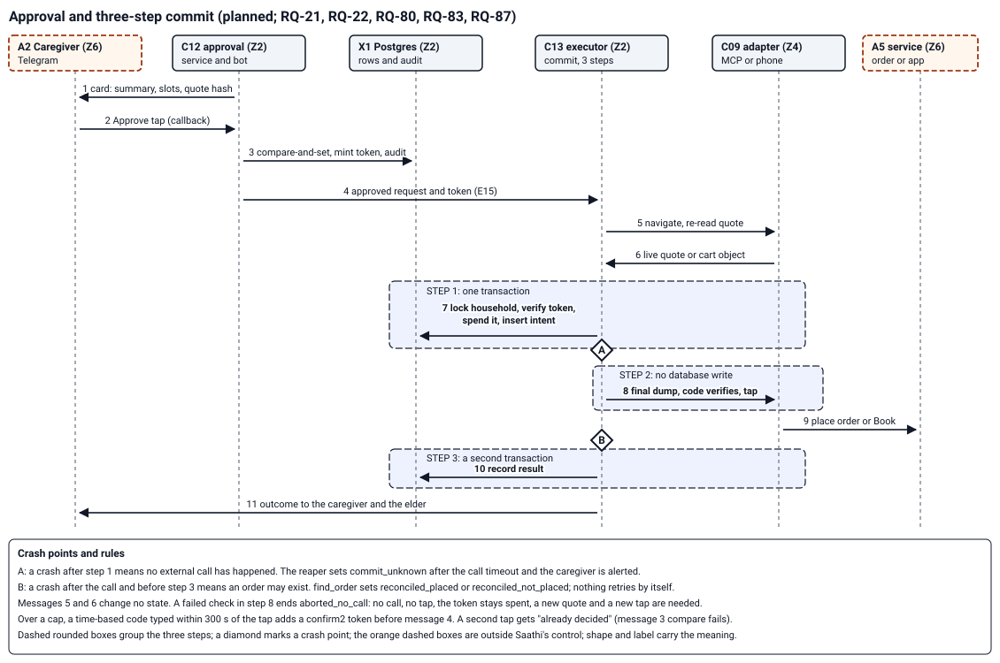

Read section 1 for how a step resumes after a restart, section 2 for the request machine and section 3 for the commit; every row of every table is one test case (section 7).

# Saathi TRD states: transitions of the five machines

## 1. Scope and conventions

State names and meanings live in SPEC-saathi-requests section 3 and are not restated. This part adds the transitions: from, event, to, guard and side effect. It adds no stored state. The token machine (section 6) uses four states derived from columns, which that table does not list (checks part, limit L-2).

1. Each transition is one Postgres transaction that updates with a compare on the old state (`UPDATE ... WHERE id = $1 AND state = $2`). Zero rows changed means the event lost a race: nothing else happens, and an approval event writes an audit row `deny`.
2. A terminal state is never rewritten. A later event on a terminal row is logged and ignored.
3. Every outbound effect carries an idempotency key built from the inbox id, the attempt id or the commit_intent id (RQ-79, RQ-80).
4. A restart resumes every non-terminal row from Postgres by its due time. Marks: P for every row; the code facts are in the checks part.
5. Resume without a checkpointer (D-70). The `requests` row carries `intent`, `slots`, `quote_id` and `plan_step`. Every step loads the row, runs the one idempotent step that `plan_step` names, and writes its effect keys, the new slots and the next `plan_step` in one transaction that compares the old state and step. No step reads state from process memory, so a restarted process continues from the row.
6. How events enter. An elder's answer to a question is a new inbox row. Classification (RQ-39 step 4) finds the open request by elder and state, so the answer needs no inbox row of the original message. An approval tap, an Acknowledge tap and every other Telegram callback enter through the approval service C12, not the inbox: it inserts the update id into `tg_updates` first (a repeat inserts nothing and is ignored), finds the card by the callback nonce, and applies the transition to the `request_id` on that card. The Telegram offset advances only after that transaction commits.

## 2. Request machine (RQ-39)

An emergency or scam flag opens an alert event (section 4) and creates no request; the alert is the card (limit L-1). Classification order and queue limits are in RQ-39 and are not repeated.

| Id | From | Event | To | Guard | Side effect |
|---|---|---|---|---|---|
| R01 | new | worker creates the request from a leased inbox row | received | kind supported; consent row present (PL-05) | templated acknowledgement within 10 s, no model call; run record opened |
| R02 | received | consent missing or withdrawn | blocked `consent_missing` | PL-05 | summary to caregiver |
| R03 | received | router outcome (a) | quoting | confidence at or above the floor; required slots present | planner starts |
| R04 | received | router outcome (b) | clarifying | a slot missing or confidence between floors; fewer than 2 questions asked | one question to the elder; `questions_asked` plus 1 |
| R05 | received | outcome (c), medicine or bill intent, router failure | handoff `summary_only` | none | summary to caregiver; elder hears "caregiver ko bata diya" |
| R06 | received | intent needs no commit and the reply is sent | done | effects sent | reply sent; a reminder writes its timer row |
| R07 | clarifying | elder answers | quoting | required slots now present | none |
| R08 | clarifying | elder answers | clarifying | still missing; fewer than 2 questions asked | next question |
| R09 | clarifying | elder answers | handoff `summary_only` | still missing after 2 questions | summary to caregiver |
| R10 | quoting | adapter facts in; `evaluate` returns OK or needs-second-confirmation | awaiting_approval | quote hash set; household consented | card to primary; reminder and backup timers set (RQ-20) |
| R11 | quoting | `evaluate` returns deny | blocked `policy_denied` | none | summary with reasons |
| R12 | quoting | no access, no `find_order`, phone offline, or macro checkpoint failed | handoff with that reason | one of the four | card with cart text and a deep link, or the failed step |
| R13 | awaiting_approval | approve tap | approved | registered approver; card hash equals current hash; no cap needs a second code | token `approve` inserted; audit `decided`; card edited |
| R14 | awaiting_approval | approve tap over a cap | awaiting_approval | registered approver; hash matches | token `approve` inserted; code prompt; the code window is the token expiry: 300 s for a cart, 180 s for a ride (section 6) |
| R15 | awaiting_approval | valid second code | approved | `approve` token unspent and unexpired; step greater than `last_step` | token `confirm2` inserted; `last_step` set; audit |
| R16 | awaiting_approval | reject tap | rejected | registered approver | reason chip stored; tokens voided; audit |
| R17 | awaiting_approval | edit tap with text | quoting | registered approver | tokens voided; new quote and hash; new card |
| R18 | awaiting_approval | cart quote TTL, reminder or backup due, urgent refresh due | quoting | timer fired | live re-read; card edited in place with the new hash; tokens voided |
| R19 | awaiting_approval | amendment targets this request | superseded | before commit step 1 | tokens voided; card edited; new request created |
| R20 | received, clarifying, quoting, awaiting_approval | request expiry | expired | class has an expiry (not an urgent ride) | caregiver summary; elder hears "abhi nahi ho paya, caregiver ko bata diya" |
| R21 | awaiting_approval | `urgent_refresh_max` refreshes with no tap | handoff `urgent_refresh_limit` | urgent ride | elder and card told to phone |
| R22 | approved | step 1 commits (section 3) | committing | household lock; token verified and spent; pause false; `authorize_commit` allows on the live re-read; caps checked on the ceiling | commit_intent `attempting`; audit `token_spent`, `commit_intent` |
| R23 | approved | step 1 denies | blocked `paused`, `policy_denied` or `consent_missing` | the transaction rolled back | tokens voided in a second transaction; audit `deny`; caregiver summary |
| R24 | committing | intent `committed` | done | none | elder reply from the confirmation; RQ-31 compare |
| R25 | committing | intent `rejected_by_service` | failed `service_rejected` | none | caregiver summary |
| R26 | committing | intent `aborted_no_call` | blocked `verify_failed` or `paused` | none | caregiver alert |
| R27 | committing | intent `timeout` | timeout | none | caregiver alert; reconcile job queued |
| R28 | committing | reaper finds no step 3 after the call timeout | commit_unknown | none | caregiver alert; reconcile job queued |
| R29 | timeout, commit_unknown | `find_order` found the order | done, reason `reconciled` | none | outcome to caregiver and elder |
| R30 | timeout, commit_unknown | `find_order` found no order | failed `reconciled_not_placed` | none | caregiver summary; a new attempt needs a new quote and tap |
| R37 | timeout, commit_unknown | a late step 3 records the provider reference (I09) | done, reason `late_result` | intent not yet reconciled | outcome to caregiver and elder |
| R38 | timeout, commit_unknown | a late step 3 records a refusal (I10) | failed `service_rejected` | intent not yet reconciled | caregiver summary |
| R39 | timeout, commit_unknown | `find_order` unsupported, or failing until `reconcile_owner_timeout_s` (config, default 24 h) (I11) | handoff `manual_reconcile` | none | owner alert; card to the caregiver saying the outcome is unknown; the intent and its day-cap hold stay until the owner records a resolution (I12) |
| R31 | timeout, commit_unknown | `find_order` errors | unchanged | before the owner timeout of R39 | retry with backoff; owner alert after the configured count; no retry of the order |
| R32 | received, clarifying, quoting, awaiting_approval, approved | cancel phrase | cancelled | before step 1; never gated by pause, tier or budget | confirmation to the elder; tokens voided; card edited |
| R33 | committing | cancel phrase | handoff `cancel_after_commit_start` | after step 1 | card with the service's cancel path; the helper never cancels; the intent still settles and its outcome goes on the card |
| R34 | any state before step 1 | withdrawal confirmed ("haan") | cancelled `withdrawal` | one confirmation sent | approvals cancelled; tokens voided; card edited; erasure starts (PL-29) |
| R35 | committing, timeout, commit_unknown | withdrawal confirmed | unchanged | from step 1 on | the commit finishes or times out, `find_order` reconciles, the caregiver gets the outcome, rows are erased once terminal |
| R36 | received, clarifying, quoting, awaiting_approval | channel down, window closed, budget spent, refusal | blocked with that reason | the rule holds at that moment | caregiver summary; refusal never retried on another tier |

## 3. commit_intent machine (RQ-80)

| Id | From | Event | To | Guard | Side effect |
|---|---|---|---|---|---|
| I01 | new | step 1 transaction commits | attempting | R22 guards | token `spent_at`; audit rows; household lock released at commit |
| I02 | attempting | step 2 check fails (RQ-87 or cart compare), or pause or consent fails on re-read | aborted_no_call | no call and no tap happened | audit `commit_result`; token stays spent |
| I03 | attempting | call returned with a provider reference; step 3 commits | committed | none | audit `commit_result` with the reference hash |
| I04 | attempting | service refused; step 3 commits | rejected_by_service | none | audit `commit_result` |
| I05 | attempting | call hit its time cap; step 3 commits | timeout | none | alert; `find_order` queued |
| I06 | attempting | reaper: no step 3 after the call timeout | commit_unknown | none | alert; `find_order` queued |
| I07 | timeout, commit_unknown | `find_order` found the order | reconciled_placed | none | audit; request R29 |
| I08 | timeout, commit_unknown | `find_order` found no order | reconciled_not_placed | none | audit; request R30; day total drops it |
| I09 | timeout, commit_unknown | step 3 arrives late with a provider reference | committed | compare on the old state; not yet reconciled | audit `commit_result`; request R37 |
| I10 | timeout, commit_unknown | step 3 arrives late with a refusal | rejected_by_service | same | audit `commit_result`; request R38 |
| I11 | timeout, commit_unknown | `find_order` unsupported, or failing until the owner timeout | unchanged | none | owner alert; request R39; the day-cap hold stays |
| I12 | timeout, commit_unknown | the owner records a manual resolution, placed or not placed | reconciled_placed or reconciled_not_placed | an owner command writes a `control` row that names the owner | audit; caregiver told; `reconciled_not_placed` drops the day-cap hold |

The intent never returns to `attempting` and nothing retries it. The reaper acts after `reaper_after_s`, which must exceed `call_timeout_s` plus `grace_s`; startup refuses a config where it does not, so a live call is not reaped. A step 3 that still arrives after the reaper is accepted (I09, I10), and the day total reads the intent state, so a `manual_reconcile` handoff still counts until I12. A terminal request state is not overwritten when its intent settles (R33).

Figure 2. Shows: the eleven messages from the card to the outcome, the three steps of RQ-80 and the two crash points. Omits: the exits I09 to I12, the backup approver's card and timers, the second-confirmation exchange beyond its note, the difference between an MCP flow and a phone flow inside message 8, reminders, and every message to the elder except the outcome. Checked against: safety RQ-21, RQ-22, RQ-80, RQ-83 and RQ-87, the transitions R13 to R30 and I01 to I08 above, and the components C09, C12, C13 and X1 in the core part. Inspected: rendered to PNG by the drafting agent and read; one label overlap fixed after the first render; reader check not run.

## 4. Alert event machine (RQ-18)

The `stage` field holds the highest stage started; earlier stages keep their cadence until their cap. Phase 0 alerts run on `alert_events.next_due_at`, not on the Phase 1 `timers` table. Stage b runs against a fake provider in Phase 0, so the T-01 wording is needed for the Phase 1 live stages; the owner submits T-01 for approval before then (PRD section 7).

| Id | From | Event | To | Guard | Side effect |
|---|---|---|---|---|---|
| A01 | new | radar flag persisted | open, stage a | emergency or scam | the edge inserts the event in the inbox transaction (text, caption) or the worker inserts it (ASR or OCR text), `next_due_at` = t0; C14 writes the attempt rows on its next poll and sends Telegram to primary and backup with the original audio, and the stored clip to the elder, keyed by the event id |
| A02 | open | cadence due | open | no acknowledgement; stage a under 20 sends per approver | attempt row with key; sends at 0, 60, 120, 180, 240 s, then every 5 min |
| A03 | open | t0 plus 2 min | open, stage b | emergency; no acknowledgement; SO-1 valid; WhatsApp not down | template T-01 per approver, every 2 min, 3 at most |
| A04 | open | t0 plus 4 min | open, stage c | emergency; no acknowledgement; SO-1 valid | call primary, backup 60 s later; every 3 min; 3 per approver and `voice_calls_per_event` per event; the call plays the fixed message and waits for the key press |
| A05 | open | t0 plus 2 or 4 min with SO-1 missing or expired | open | none | stages b and c send nothing; owner alerted; stage a continues |
| A06 | open | Acknowledge tap (Telegram callback, rule 6) | acknowledged | registered approver; update id not seen before | unsent attempts cancelled; a ringing call may finish; follow-up at 15 min. An answered call with no key press is not an acknowledgement (A12, A13; T-33) |
| A07 | open | every cap spent with no acknowledgement | blocked `no_human_reached` | none | ops chat record; audit row |
| A08 | acknowledged | false-alarm tap | acknowledged | registered approver | flag set; counted per approver when stage b or c had started |
| A09 | open | t0 plus 10 min with no acknowledgement | open | emergency | the 108 and 112 clip sent to the elder again |
| A10 | any non-terminal | restart | unchanged | none | resume by `next_due_at` |
| A11 | new | audio row not scanned: rate limited, `not_before` in the future, `dead`, or no ASR text after `radar_audio_max_s` (config, default 120 s) | open, kind `unscanned`, stage a | audio rows only | the edge (rate limit, `not_before`) or C14 (dead, overdue) inserts the event with the audio attached; no stages b or c; not counted in the false-alarm budget; ends on an Acknowledge tap |
| A12 | open, stage c | key press of 1 on a stage c call (provider callback) | acknowledged | signature valid; call id matches an attempt row of this event; callback not seen before; the digit is 1 | unsent attempts cancelled; a ringing call may finish; audit row `ack_voice` naming the approver of that attempt; follow-up at 15 min (T-33, T-40) |
| A13 | open, stage c | call answered with no key press, voicemail, another key, hang up or no answer | open, stage c | none | the attempt is marked `answered_no_ack`, `voicemail` or `failed`; the cadence and caps continue; audit row `call_no_ack` |

A scam alert and an `unscanned` alert use stage a only (A01, A02, A06, A07, A11).

## 5. Inbox machine (RQ-79, RQ-81)

| Id | From | Event | To | Guard | Side effect |
|---|---|---|---|---|---|
| N01 | new | valid webhook | received | signature valid; sender registered; body within the size limit; `provider_message_id` unique | insert the `inbox` row and its `raw_text` rows in one transaction, commit, then 200; a unique conflict inserts nothing and still returns 200 |
| N02 | new | invalid signature | no row | none | 401; counter plus 1 |
| N03 | new | unregistered sender | no row | none | `rejected_inbound` row with a keyed hash; no reply; weekly digest count |
| N04 | new | sender over the rate limit | received | 20 messages in 10 min | row has `not_before`; one acknowledgement; the edge keyword match still runs on text and captions, and an audio row opens A11 |
| N05 | received | worker leases | leased | oldest unprocessed row of its elder, `SKIP LOCKED`; `not_before` passed; attempts under 5 | `lease_until` and `lease_token` set; `attempts` plus 1 |
| N06 | leased | lease expired or attempt failed | received | attempts under 5 | the row is free; the old worker's writes fail the token check |
| N07 | leased | effects sent | processed | every effect keyed by the inbox id | request created or updated, or an alert event opened |
| N08 | leased | kind unsupported | unsupported | sticker, contact, location | summary to caregiver |
| N09 | leased | media fetch failed inside the URL lifetime | media_lost | none | flagged notice to caregiver |
| N10 | leased | fifth failed attempt | dead | none | caregiver alert; audit row; an audio row opens A11; the elder's later rows become leasable |

A body that is not valid JSON after a good signature returns 400 and writes no row; a body over the limit returns 413.

Lease and order rules (RQ-79):

1. Per-elder order. A worker leases only the oldest unprocessed row of an elder: it takes `pg_try_advisory_xact_lock` on the elder id while it sets the lease, and refuses an elder that has a `leased` row with a live lease. Rows still waiting for `not_before` do not block newer rows.
2. Lease and renewal. `lease_s` defaults to 60. A step that can outlast it (ASR, a model call) runs a heartbeat that sets `lease_until` to now plus `lease_s` every `lease_s` / 3, `WHERE lease_token = $token`. A renewal that changes no row means the lease is lost: the worker stops and writes nothing. A step ends after `step_max_s` (default 300) even while renewing.
3. Double-run protection. Every worker write and every transition names the `lease_token`; every effect carries the inbox id as its key; `attempts` counts leases, so a row that keeps stalling dies after 5. A worker that wakes after its lease expired finds a stale token and discards its result.
4. Acknowledgement. The 10 s acknowledgement of RQ-74 is a separate pass over rows with `acked_at` null, outside the per-elder order, keyed by the inbox id, so a queued message is acknowledged on time.

Where the radar runs (RQ-16, RQ-82). The keyword layer needs no lease, no ASR and no model.

| Path | G0 runs in | When | If it cannot run |
|---|---|---|---|
| Text message | C01 | at insert, before the 200; a hit adds the alert event to the same transaction | the insert fails, the answer is 5xx and the platform retries (T-09) |
| Caption on an image, video or document | C01 | at insert | same |
| Rate-limited or `not_before` text or caption | C01 | at insert, the same as above | same |
| Audio | C02, on ASR text, with G1 beside it | after ASR | A11 opens an `unscanned` alert; the original audio goes to the caregiver (RQ-82) |
| Image or video with no caption | C02, on OCR text | after vision, under a receipt (RQ-96) | handoff with the original media; no scan |
| Caregiver forward | C12 intake | at insert, as for text | same |

## 6. Approval token machine (RQ-22)

Stored columns: `spent_at`, `voided_at`, `expires_at`. The states are read from them: issued (all clear, `now` before `expires_at`), spent, voided, expired.

| Id | From | Event | To | Guard | Side effect |
|---|---|---|---|---|---|
| K01 | new | R13 or R14 (approve tap) | issued | registered approver; request in awaiting_approval | `expires_at` is the tap time plus 300 s for a cart, 180 s for a ride that needs the second confirmation (D-77) or 60 s for any other ride |
| K02 | new | R15 (valid code) | issued, action `confirm2` | `approve` token unspent | `expires_at` equals that of the `approve` token |
| K03 | issued | commit step 1 | spent | request id, quote hash, approver and action match; unexpired; not voided; one `UPDATE ... WHERE spent_at IS NULL` changes one row | audit `token_spent` |
| K04 | issued | supersede, edit, reject, cancel, withdrawal, refresh, step 1 denial, revocation runbook | voided | none | `voided_at` set; audit `token_voided` naming the request |
| K05 | issued | clock passes `expires_at` | expired | none | none |
| K06 | spent, voided, expired | any use | unchanged | none | audit `deny`; no effect |

One clock runs from the first tap: the expiry of the `approve` token. It is 300 s for a cart, 180 s for a ride over a cap (D-77) and 60 s for any other ride. The code window equals it, and the `confirm2` token never outlives it, so a code typed after 180 s on a ride gets the expired reply and needs a new tap. The live re-read at commit step 1 still guards the price. The SPEC wording "a card is out; the token is unspent" is read here as: a token exists only after a tap, because the timers table counts expiry from the tap.

## 7. Tests

A table-driven test loads sections 2 to 6, runs one case per row, and asserts that every (from, event) pair absent from a table is refused and leaves the row unchanged. A row added with no case fails the test. The test is shown to fail by deleting one row (TQ-04). A resume test (TQ-65) starts a request in each non-terminal state, kills the process, restarts it with no in-memory state, delivers the answer or the tap through its entry path (rule 6) and asserts the same end state as an uninterrupted run. A lease test covers per-elder order, renewal of a slow step, a stalled worker that wakes after expiry and a replayed Telegram update id.

Skipped or not checked: figure 2 rendered and inspected by the drafting agent, reader check not run, and its viewBox grew to 790 and two note lines were wrapped after review G, and the rendering was not inspected again; no machine exists in code; the tables were compared with SPEC-saathi-requests section 3 by reading, not by a script; the Hindi phrases are examples; timings are config defaults from the SPEC and were not measured.
